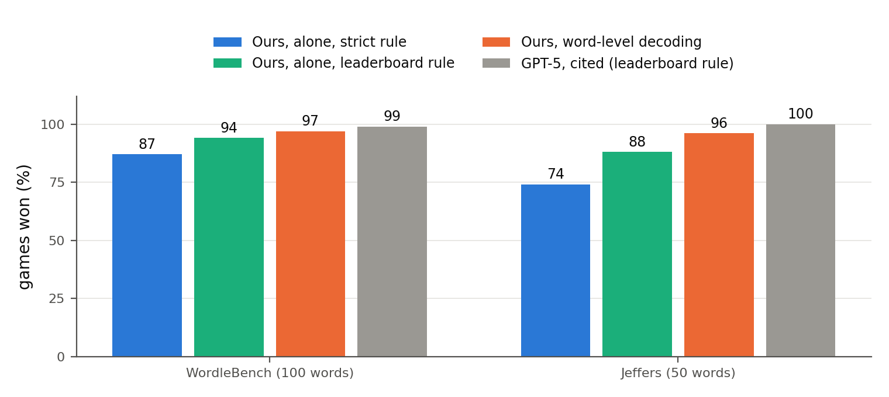
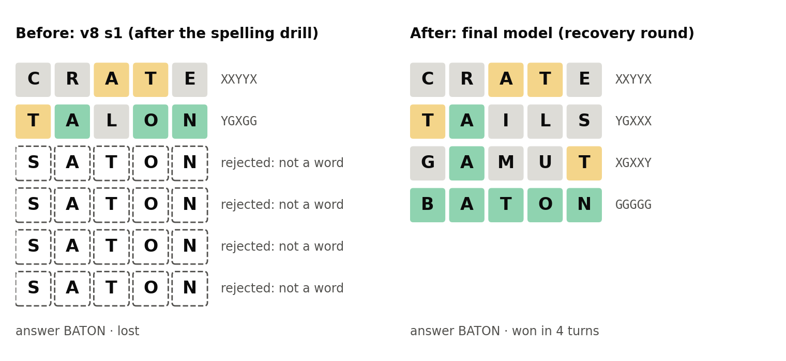

<div align="center">

# Five Letters, 270M Parameters

**How far can a tiny language model go at Wordle?**

Gemma 3 270M, trained on free Kaggle GPUs to play Wordle through text. Total compute cost: $0.

**[▶ Watch it play, live in your browser](https://huggingface.co/spaces/aafimalek2032/five-letters)**

[Model](https://huggingface.co/aafimalek2032/wordle-rl-gemma3-270m) ·
[Data and every evaluation game](https://huggingface.co/collections/aafimalek2032/five-letters-wordle-rl-6af332879e666b4001ede7ed) ·
[Paper source](paper/main.tex) ·
[All results](docs/RESULTS.md)

[](https://doi.org/10.5281/zenodo.24114970)

</div>



## Results

The final model was declared before any test set was scored, and each test set was scored once.

| Test set | Model alone, strict rule | Model alone, leaderboard rule | Word-level decoding | GPT-5 (cited) |
|---|---|---|---|---|
| WordleBench (100 words) | 87.0% | 94.0% | **97.0%** · 3.68 guesses | 99% · 3.59 guesses |
| Jeffers Wordle-AI-Benchmark (50 words) | 74.0% | 88.0% | **96.0%** · 3.75 guesses | 100% · 3.58 guesses |
| TextArena Wordle-v0 (500 games) | 85.8% | – | **98.6%** · 3.59 guesses | – |
| Rare answers (500 words) | 42.2% | 51.4% | 76.6% · 4.60 guesses | – |

- **Strict rule:** a guess that is not in the 12,972-word dictionary gets no feedback and uses the turn.
- **Leaderboard rule (open-vocab):** any five letters get feedback. We read the scoring code of both leaderboards, and neither checks guesses against a dictionary.
- **Word-level decoding:** the output is limited to dictionary words, which the model ranks itself. The code never looks at the clues.
- GPT-5's scores come from the leaderboards: other harnesses, prompts and settings, on the same word sets.

Confidence intervals, the retry-3 rule and the development sets are in [docs/RESULTS.md](docs/RESULTS.md).

## What limits a tiny model at Wordle

We read the lost games after each training round, named the most frequent failure, and wrote training data for that failure only. Three failures appeared, one after the other:

1. **Memorising instead of reading the clues.** Trained only on solver games for its training answers, the model memorised them. A solver that plays only clue-consistent words, and games on extra common words, fixed this.
2. **Spelling, not strategy.** The model then followed the clues but could not recall a real word that fits them. A balanced spelling drill raised the model-alone win rate on the 534-word selection set from 62.0% to 83.1% (mean of three seeds).
3. **Stuck on a rejected word.** After the drill, when the game rejected a non-word, the model wrote the same word again until the game ended. One round of training on boards with the model's own rejected words cut these losses from 71 to 15 and raised the selection score from 83.9% to 88.0%.



GRPO, a stronger teacher, whole-word output and self-distillation did not help. The paper reports them as negative results.

## Quick start

```bash
pip install -e ".[train,dev]"
python -m fiveletters check     # word lists and frozen splits match their checksums
python -m pytest                # about 6 minutes on a laptop CPU

# play the 100 WordleBench words with the final model and word-level decoding (CPU is fine)
huggingface-cli download aafimalek2032/wordle-rl-gemma3-270m --local-dir models/final
python -m fiveletters eval --policy hf --model models/final --split wordlebench --constrain wordle --constrain-mode word

# replay every saved game with an independent implementation of the rules
python scripts/audit_eval.py runs/eval/wordlebench/<folder>
```

## Reproducing the paper

| Step | Command or file |
|---|---|
| Training data of a round | `python -m fiveletters traces ...`, `drill ...`, `recovery-data ...`; the settings of each round are in its [dataset card](https://huggingface.co/collections/aafimalek2032/five-letters-wordle-rl-6af332879e666b4001ede7ed) |
| Training and evaluation | `kaggle/plans/<round>.json` lists the exact commands of each Kaggle session; `python kaggle/job.py plan <file> <session>` runs one ([docs/KAGGLE.md](docs/KAGGLE.md)) |
| Every number, table and figure | `python paper/analysis.py && python paper/build.py`, then `tectonic paper/main.tex` |
| Decisions and their rules | written before each round in [docs/ROADMAP.md](docs/ROADMAP.md); results log in [docs/PAPER_NOTES.md](docs/PAPER_NOTES.md) |

The project was developed in a private repository under `projects/five-letters`, and the Kaggle and Colab launchers still clone from there. Set `REPO` and `SUBDIR` in `kaggle/job.py` and `notebooks/make_notebooks.py` to this repository and `""` before you use them.

## Repository layout

| Path | Holds |
|---|---|
| `src/fiveletters/` | game rules and feedback, solvers, prompts, evaluation harness, SFT and GRPO training, spelling drill (`drill.py`), recovery data (`recovery.py`), word-level decoding (`constrain.py`) |
| `src/fiveletters/resources/` | the dictionary, the frozen splits and their checksums |
| `scripts/audit_eval.py` | the independent audit that replays every saved game |
| `results/eval-v1/` | the summary of every evaluation |
| `kaggle/` | the Kaggle launcher and the plan of every session |
| `paper/` | the paper source; `build.py` generates its numbers, tables and figures from `results/` |
| `docs/` | [results](docs/RESULTS.md), [evaluation protocol](docs/PROTOCOL.md), [roadmap](docs/ROADMAP.md), [results log](docs/PAPER_NOTES.md), [free-tier notes](docs/FREE_TIER.md), [Kaggle](docs/KAGGLE.md), [runbook](docs/RUNBOOK.md) |

## Licence

The code is Apache-2.0. The model is a fine-tune of Gemma 3 and is subject to the [Gemma Terms of Use](https://ai.google.dev/gemma/terms). `paper/arxiv.sty` is MIT-licensed.

## Citation

The paper (preprint, Zenodo):

```bibtex
@misc{malek2026fiveletters,
  title  = {Five Letters, 270M Parameters: How Far Can a Tiny Language Model Go at Wordle?},
  author = {Malek, Aafi Khan},
  year   = {2026},
  doi    = {10.5281/zenodo.24116756},
  url    = {https://doi.org/10.5281/zenodo.24116756}
}
```

The code (this repository): [10.5281/zenodo.24114970](https://doi.org/10.5281/zenodo.24114970). Author ORCID: [0009-0008-3211-5028](https://orcid.org/0009-0008-3211-5028).
