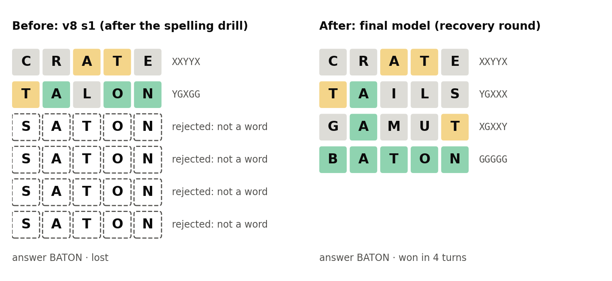
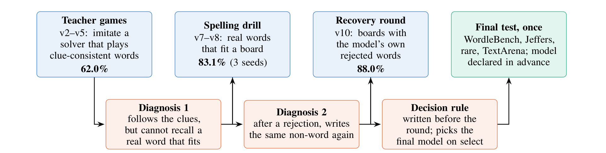
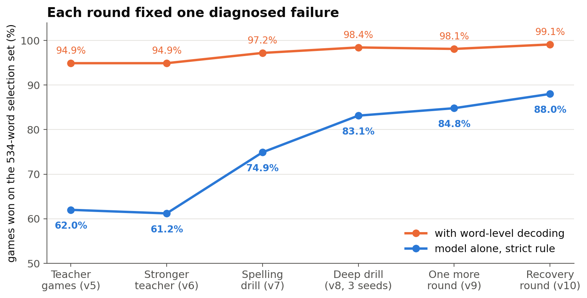
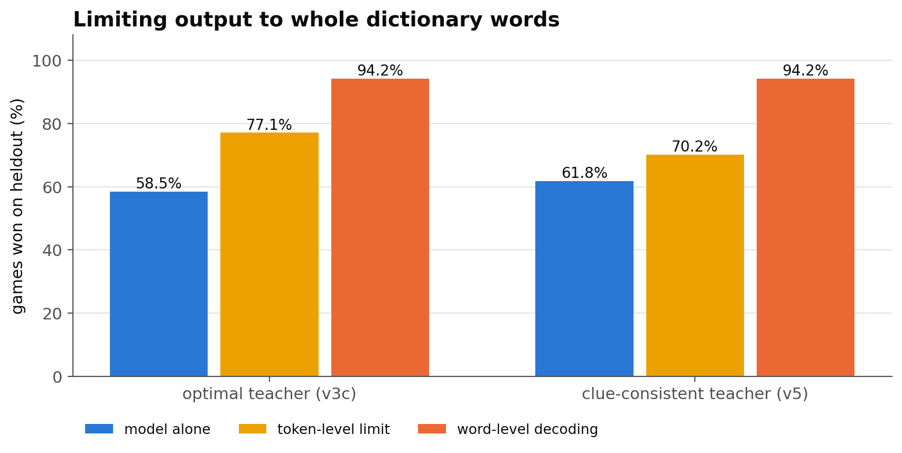
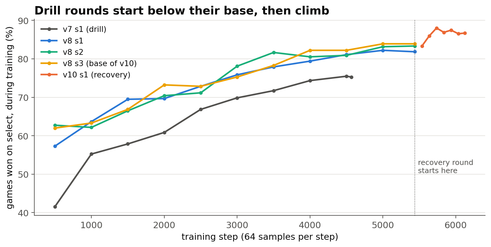
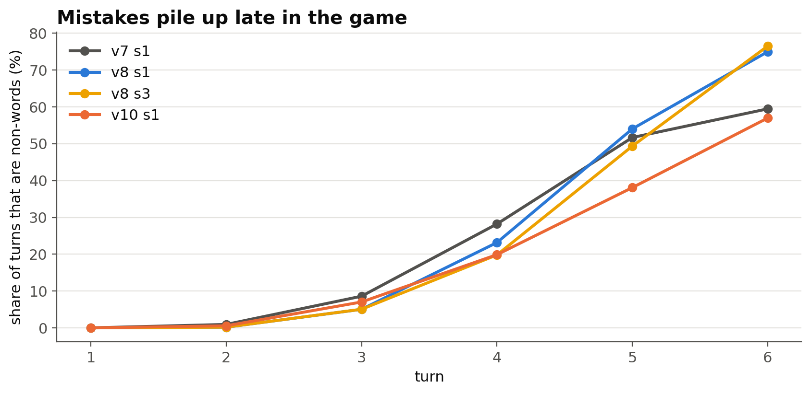
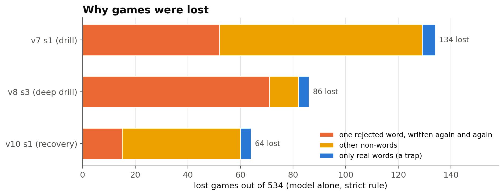
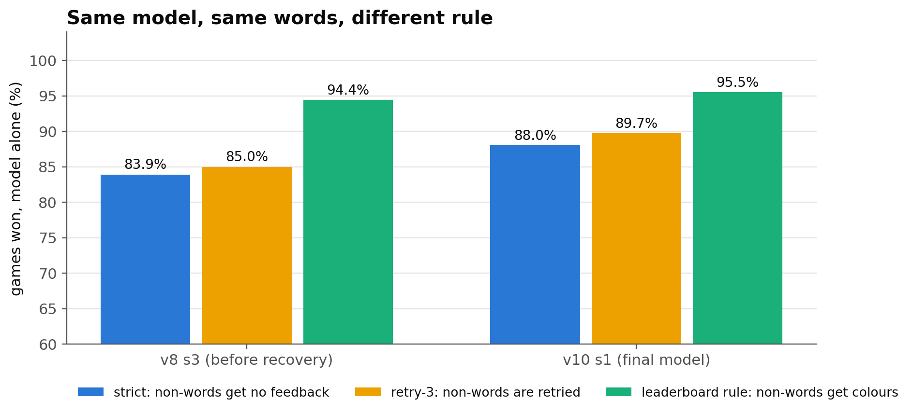
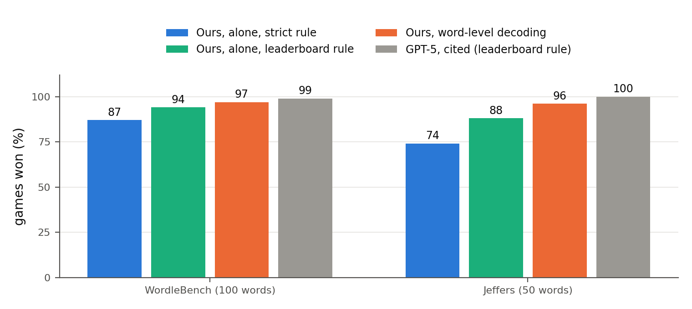
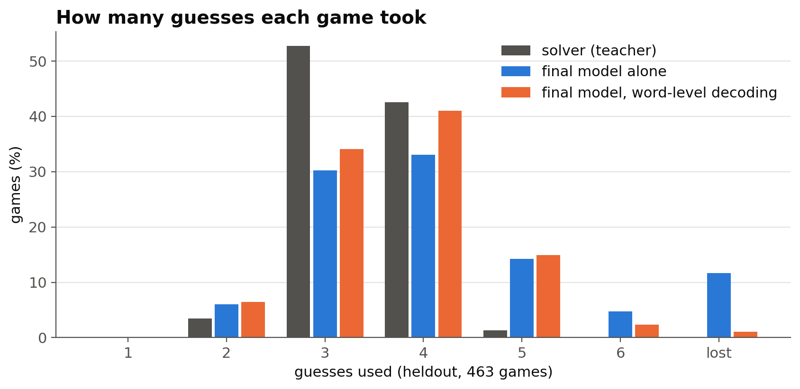

# I Taught a 270M-Parameter Model to Play Wordle on Free GPUs. Its Problem Was Never Strategy.

### How reading lost games, not a bigger model, took a tiny language model to 97% on WordleBench, and what I found inside two public leaderboards



Frontier models win almost every game of Wordle. On the public WordleBench leaderboard, GPT-5 wins 99 of 100 games, and many other large models win between 94 and 98.

I wanted to know how far a very small model could go if I trained it for this one game and paid nothing for compute. So I took Gemma 3 270M, a language model with 270 million parameters, small enough to run on a laptop CPU, and trained it on free Kaggle notebook GPUs.

The final model wins 97 of 100 WordleBench games when its guesses are limited to dictionary words, 94 with no help under the leaderboard's own rules, and 87 under a stricter rule that I explain below. But the score is not the most interesting part. The interesting part is *why* the model lost the games it lost, and what I found when I read the scoring code of the leaderboards I was comparing against.

This is the full story, with every detail: the setup, the three failures and their fixes, the numbers, what didn't work, the free-tier problems, and what is still wrong.

**Links:** [live demo](https://huggingface.co/spaces/aafimalek2032/five-letters) (runs in your browser) · [paper](https://doi.org/10.5281/zenodo.24116756) · [code and data](https://github.com/Aafimalek/wordle-rl) · [model](https://huggingface.co/aafimalek2032/wordle-rl-gemma3-270m)

**The short version**

- A 270M-parameter model, trained only on free GPUs, wins 97% of WordleBench games with dictionary-limited decoding (GPT-5: 99%), 96% of Jeffers games (GPT-5: 100%) and 98.6% of 500 TextArena games.
- With no help at all, under the leaderboard's own rules, it wins 94% of WordleBench games. That is the score listed for gpt-5-mini.
- Its losses never came from strategy. They came from three things, found one after the other by reading lost games: memorising answers, not being able to spell, and typing the same rejected word again and again.
- Each fix was a small change to the training data, not a new algorithm. Reinforcement learning did not help.
- Both public Wordle leaderboards I checked accept non-words as guesses. On the same words, that one rule moves my model's score by 7 to 11 points.
- Total compute cost: $0.

---

## Part 1: The setup

### Why Wordle is a good test

Wordle has complete, simple rules. You get six guesses to find a hidden five-letter word. After each guess, every letter is marked green (right letter, right place), yellow (in the word, somewhere else) or grey (not in the word). Repeated letters follow an official rule: greens are assigned first, then a guessed letter is yellow only while the answer still has an unmatched copy of it.

The game is solved. The optimal strategy needs 3.4212 guesses on average over the 2,315 classic answers and wins every game. And you don't even need strategy to win most games: in my measurement, a player that simply guesses *any* dictionary word that fits every clue so far wins 98.5% of games, with 4.07 guesses per win.

So when a language model loses at Wordle, the interesting question is which part it fails at. For a language model, there are two parts:

1. **Reasoning about the clues:** which letters are where, and which are out.
2. **Writing a real word, letter by letter.** This is harder than it sounds for a model that reads and writes *tokens*, not letters. To the model, "CRANE" is one or two tokens, not five characters.

The second part turned out to matter far more than I expected.

### The model

I used Gemma 3 270M, the instruction-tuned version, and trained all of its weights.

Out of the box, small models can't play this game at all under a strict protocol, because they almost never produce a valid guess in the required format. On the 463-word development set:

- Gemma 3 270M (untrained): 0.0% of games won.
- SmolLM2-360M-Instruct: 0.2%.
- Qwen3-0.6B (thinking off): 0.0%.

After the same first round of training, SmolLM2-135M reached 23.3%, SmolLM2-360M 33.7% and Gemma 3 270M 55.7%. So I continued with Gemma.

### The prompt

Each turn, the model sees the rules, the board so far and the number of turns left. Letters are spaced out, so that each letter is its own token. The model answers with a short note on what it knows, then its guess:

```
Turn 3: C R O N K -> X G G G X
Turns left: 3

<state>fixed: _ R O N _ | has: - | out: C E K L M S W</state>
<guess>F R O N D</guess>
```

G, Y and X stand for green, yellow and grey. If a guess is rejected, the board shows it like this: `S A T O N -> INVALID (not in word list)`.

### Compute: free GPUs only

Everything ran on Kaggle's free tier: notebook sessions with two NVIDIA T4 GPUs and a weekly quota of about 30 GPU hours. I launched sessions from my laptop with a small script that sends a queue of commands to each GPU, so each session trained two models side by side and then evaluated them. Across the project, the recorded sessions add up to about 31 hours. Total cost: $0.

### Training settings

- Optimiser: AdamW, learning rate 5e-5 with 100 warm-up steps and cosine decay, no weight decay, gradient clipping at 1.0.
- Batch: 64 samples per step (16 × 4 gradient accumulation), one epoch, at most 512 tokens per sample. A model's reply has a median length of 44 tokens.
- Precision: weights in fp32, compute in fp16 only after a startup check shows that fp16 and fp32 agree. More on why below.
- Checkpoint choice: the checkpoint with the best win rate on the selection set, checked every 500 steps.

## Part 2: The rules I set for myself

Small models are easy to fool yourself with, so before training anything, I froze an evaluation protocol.

**A strict rule.** The dictionary has 2,315 answers and 10,657 more allowed guesses: 12,972 words in total, with fixed checksums. Every model output uses a turn. If an output has no guess tag, or if its guess isn't one of the 12,972 words, it gets no feedback and still uses the turn. Decoding is greedy, so the same word always gives the same game. My feedback code agrees with TextArena's game engine on 10,000 test pairs.

**Separate word sets:**

- **Train**, 1,752 words: the answers of the training games.
- **Select**, 534 words: chooses checkpoints, recipes and the final model.
- **Heldout**, 463 words: a second development set, to check select.
- **WordleBench**, 100 words, and **Jeffers**, 50 words: test sets with published frontier scores.
- **Rare**, 500 words: a test set of answers outside the classic answer list.
- **TextArena Wordle-v0**, 500 games: a test set from a public game environment. Its "clean" subset is the 109 games whose secret word was never a training answer.

No training game ever used a WordleBench or Jeffers word as its answer. The test sets were scored **once**, for a model declared in advance.

**Decisions written before results.** Before each training round, I wrote down what the round tested and what I would do for each possible result. This stops you from choosing whatever number looks best afterwards, and it makes negative results easy to report.

**An independent audit.** A separate script, with its own implementation of the rules, replays every saved game from the model's raw outputs. It checks every piece of feedback and every win. Every number in this article passed it, except TextArena's, which TextArena's own engine scores.

**Metrics:** the win rate with a 95% bootstrap confidence interval, the mean number of guesses in won games, the share of turns that are invalid, and the share of guesses that contradict clues the model already had. To compare two models on the same words, I used an exact McNemar test on the games only one of them won.

## Part 3: The teacher

The training games come from a solver: a lookahead beam search over the full vocabulary. Opening with SALET, it averages 3.4216 guesses and wins all 2,315 classic games, within 0.0004 of the proven optimum.

One complication: TextArena's Wordle rejects SALET, and more than a third of the dictionary (it accepts 8,019 of the 12,972 words). So the training games use a shared vocabulary of 8,035 words (TextArena's 8,019 plus the 16 answers it doesn't list) and open with CRATE instead, which averages 3.4281 guesses with no losses.

The games also include off-script states, so the model learns to continue after mistakes: random openings, 10% random moves and some invalid turns.

## Part 4: The method, a loop of diagnosis and targeted data

The approach turned into a loop:

1. Train a round.
2. Read the games the model lost.
3. Name the most common failure.
4. Write training data for that failure only.



The loop found three failures, one after the other. Each one only became visible after the previous one was fixed.



## Part 5: Failure 1, it memorised the answers

The first model trained only on the solver's games for the 1,752 training answers. It won 20 of 20 games on words it had trained on, but only 13 of 20 on new words, and 55.7% of the heldout games. Every invalid turn on new words was an invented word. It had memorised the answer list.

Adding games on 1,610 extra common words (none of them test answers) raised heldout to 64.6%.

A subtler problem remained. The optimal solver often plays "probe" words that deliberately break the clues, to gather information. A small model can't learn when that is a good idea, so 49% of its guesses contradicted clues it already had. I switched to a **clue-consistent teacher**, a solver that only plays words that fit every clue. That cut contradictions to 7.5%, and raised heldout from 58.5% (the comparable earlier model) to 61.8%.

## Part 6: A detour, limiting guesses to real words

Before going further, I tested how much a simple decoding aid helps. If the model can only output dictionary words, it can't lose a turn to a non-word.

There are two ways to do this:

- **A token-level limit** blocks any next token that can't lead to a dictionary word. It commits to the most likely allowed first letters, then must finish whatever word starts with them.
- **Word-level decoding** runs a beam search (width 16) over a tree of all 12,972 dictionary words, written letter by letter. It returns the whole word that the model itself rates highest, skipping words already played. The code never looks at the clues: the model still decides which word fits.



Word-level decoding added 32 to 36 points over the model alone, and 17 to 24 over the token-level limit. No training change in the whole project had an effect that large. With word-level decoding, the clue-consistent teacher didn't win more games than the optimal one, but it cut clue contradictions from 44% to 9% and saved about 0.2 guesses per win. Word-level results were identical game for game on a T4 GPU and on a laptop CPU.

From here on, I report two numbers for every model: the **model alone**, and **with word-level decoding**. They answer different questions, so I never mix them.

## Part 7: Failure 2, it followed the clues but couldn't spell

Next, I read every lost game of the model alone on the selection set. The model's reasoning was fine: of the 272 games in which it never wrote an invalid word, it won 269. Its problem was elsewhere:

- Every invalid turn was a well-formed, five-letter **non-word**.
- 78% of those non-words fit every clue, and 38% were one letter away from the answer.
- 97.6% of the real words it played were words it had seen as training targets, and those covered only 6,871 of the 12,972 dictionary words.
- Its win rate rose with how often the answer had appeared as a training target: 12.5% for answers never seen, 43.6% for 1 to 9 times, 72.4% for 10 to 99 times and 77.1% for 100 times or more.

The model knew the *pattern* the answer had to match. It couldn't recall a *real word* with that pattern.

### The spelling drill

The fix was not more games. It was a **spelling drill**. Each drill sample is a board plus one real, common word that fits it, in the same prompt format. The design details mattered:

- **Balanced.** The targets are the 5,557 common English words with a word-frequency (Zipf) score of 2.0 or more, and every one is a target the same number of times. So the model practises the whole vocabulary evenly, not just the frequent words.
- **Fair.** Boards are built only around training-side hidden words, never around a development or test answer.
- **Mixed.** Half of the earlier teacher games are replayed alongside, so the model keeps its game play.
- **Round v7:** 30 samples per word, boards of 1 to 4 guesses (166,710 drill samples plus 125,633 replayed ones).
- **Round v8:** 40 samples per word, boards of 1 to 5 guesses, and up to two rejected non-words per board (222,280 plus 125,633). I made the boards deeper because v7's invalid turns were concentrated in turns 4 to 6.

### Results of the drill

The drill raised the model-alone win rate on the selection set from **62.0% to 74.9%** (v7) and then **83.1%** (v8, the mean of three training runs with different seeds: 82.2%, 83.3% and 83.9%, standard deviation 0.9). With word-level decoding, it reached 98.4%.

On the same 534 words, the first v8 model won 70 games that v7 lost, and lost 31 that v7 won: a clear improvement (p < 0.001). One more round of the same drill on fresh boards (v9) gave little: against the best v8 run it won 29 more games and lost 24 (p = 0.58, which is noise).

The training curves were interesting too. Each drill round *starts below* the model it began from, then passes it. v7 fell to 41.6% at its first checkpoint, from 62.0%. v8 runs fell to 57 to 63%, from 74.9%. They only overtook their starting model after about 3,000 steps.



### An honest disclosure about the drill

Drill targets can be any common English word, so 527 of the 534 selection words, and 147 of the 148 leaderboard words, appear as spelling targets on boards built around *other* hidden words. No test word is ever the *answer* of a training game.

To measure what this choice does, I also trained a strict variant (v7s) in which no development or test word is ever a target. It scored 56.2%, *below* its starting model. When the drill never shows a word, the model spells that word worse than before. Two explanations fit: spelling is learned word by word, or the model learned that about 800 words (exactly the likely answers) are never the right output. My data can't tell them apart, so every drill-based number depends on this disclosed choice.

## Part 8: Failure 3, when the game said "not a word", it wrote the same word again

After the drill, the model rarely wrote a non-word. Invalid turns were rare in turns 1 to 3 and grew late in the game, when fewer words fit the clues.



But when it did write a non-word, something strange happened. Here is a real game, with the hidden word BATON:

```
CRATE  -> X X Y Y X
TALON  -> Y G X G G
SATON  -> INVALID (not in word list)
SATON  -> INVALID (not in word list)
SATON  -> INVALID (not in word list)
SATON  -> INVALID (not in word list)
```

The prompt shows the rejection, but the model's notes don't change, and it writes SATON again until the game ends. This was the rule, not the exception:

- The first v8 model wrote a non-word in only 91 of 534 games, and lost every one of them. After its first non-word, its next turn was **the same word 88 times and a different real word once**.
- The v8 run I later used as the base: the same word 76 times, a real word 8 times. 71 of its 86 losses were one non-word, repeated.

This also explained two earlier numbers. The retry-3 rule (a rejected word doesn't use a turn, up to three times in a row) only added about 2 points, because the model spent its retries on the same word. And under the leaderboard rule, where the same non-word *gets* colours, the board changes and the model moves on, so it scored about 11 points higher.

Why does this happen? It's a classic problem in imitation learning called **covariate shift**. The model had only ever trained on states that a good player creates. The drill boards did contain rejected words, but they were random near-misses, never the word the model itself was about to write. It had never seen a board on which *its own* first choice had just been rejected.

### The recovery round

The fix, in the spirit of an imitation-learning method called DAgger, was to train on the model's own mistakes:

1. **Let the model play.** The base model played 8,546 hidden words alone: every valid word that is neither a test or development answer nor an answer it had trained on. Each of the two GPUs took half (4,273 words). These words are rarer than the answer lists, so the base won only 1,340 and 1,403 of them.
2. **Keep its own mistakes.** Each first time the game rejected one of the model's own non-words, with a turn left, I kept that exact board, rejection included. There were 2,261 and 2,162 such moments.
3. **Label them.** Each moment became up to four training samples, with a real word that fits the clues as the target. One of the targets is always the hidden word. With probability 0.3, the board shows the rejection twice, as when the model repeats it. The data generator refuses to run if a game's answer is a development or test word.
4. **Train briefly.** 3,077 and 2,879 recovery samples, mixed with 4% of the v8 data as replay (about 22,000 samples in total), for two epochs at a lower learning rate (2e-5, 30 warm-up steps), checking the selection set every 100 steps. Each run took about 30 minutes on one T4.

One detail: my written plan said 4,000 hidden words. A quick laptop check showed that would give too few samples, so I changed it to all 8,546 before launch, before any result existed, and recorded the change.

The recovery round behaved differently from the drill: it started at the level of its base and peaked early, at step 300 of 688.

### Results of the recovery round



- After a first non-word, the model now writes a real word 51 times and repeats the rejected one 32 times (before: 8 and 76).
- Games with exactly one invalid turn are now won 39 of 42 times (before: 3 of 8).
- Losses that consist of one repeated non-word fell from **71 to 15**.
- Model-alone wins on the selection set rose from **83.9% to 88.0%**. On the same words, the new model won 47 games the base lost and lost 25 that the base won (p = 0.013). A second run with a different seed scored 87.3% (36 against 18, p = 0.020), and the two runs don't differ significantly from each other (p = 0.70).
- The checkpoint was chosen on the selection set, so that score is slightly optimistic. The heldout set played no part in this round and rose by about the same amount: 84.7% to 88.3%.

Two problems remain. The model now writes a first non-word a bit more often (in 101 games, against 85). And games with three or more invalid turns are still always lost (0 of 41). In most of those, the model no longer repeats one word: it tries several *different* non-words. The gap left is spelling again, under pressure late in the game.

## Part 9: What I found inside two public leaderboards

To compare with frontier models, I read the scoring code of the two public Wordle leaderboards whose word lists are published.

**Neither checks guesses against a dictionary.**

- **WordleBench** (`main.py`, commit 79436c8) scores whatever text is inside the guess tag. There is no word list and no length check. Its yellow rule also ignores repeated letters, so it is simpler than real Wordle. Models run through OpenRouter with reasoning set to high.
- **Jeffers Wordle-AI-Benchmark** (`lib/wordle-engine.ts`, commit a79acdb) accepts any five lowercase letters. Its code *imports* a dictionary check but never calls it. Malformed or repeated guesses are replaced by an unused starter word.
- **SnorkelWordle** publishes scores but not its word list, so I couldn't run on it.

So on both leaderboards, a misspelled guess like SATON still gets colours, and the game moves on. Under my strict rule, it gets nothing.

That matters a lot, because misspelling was exactly my model's weakness. The same model, on the same words, scores very differently depending on that one rule:



Before the recovery round, the gap between the strict rule and the leaderboard rule was 10.5 points. After it, the gap shrank to 7.5, which agrees with the diagnosis: the leaderboard rule hides exactly the failure the recovery round fixed.

So I report three labelled rules everywhere:

- **Strict** (my headline): a non-word gets no feedback and uses the turn.
- **Retry-3:** a non-word doesn't use a turn, at most three times in a row.
- **Open-vocab:** any five letters a to z get feedback and use a turn, like the leaderboards. Malformed output still loses the turn.

I think every game benchmark for language models should state this rule, because it can move a score by 10 points.

## Part 10: Choosing the final model before looking at the test

Each choice used a rule written before its result existed:

- **After v8:** if the v8 mean beat v7 by at least 2 points, with at least 96% using word-level decoding, v8 would be the final recipe. It did (83.1% and 98.4%).
- **v9 against v8:** v9 would replace the best v8 run only if it beat the v8 mean by 2 points, so it needed 85.15%. It scored 84.8%, so the best v8 run (83.9%) became the base for the recovery round.
- **v10 against its base:** the better recovery run would become the final model if it gained at least 2 points alone (at least 85.9%) and lost at most 1 point with word-level decoding (at least 97.7%). It scored 88.0% and 99.1%, so it became the final model.

I declared it in writing before any test set was scored. The test then ran once, in a single Kaggle session of 54 minutes (after about an hour in Kaggle's queue).

## Part 11: The final test, scored once



**WordleBench, 100 words**

- Model alone, strict rule: 87.0% (3.79 guesses per win)
- Model alone, retry-3: 87.0%
- Model alone, leaderboard rule: 94.0%
- Word-level decoding: **97.0%** (3.68 guesses per win)
- GPT-5, cited from the leaderboard: 99% (3.59 guesses per win)

**Jeffers Wordle-AI-Benchmark, 50 words**

- Model alone, strict rule: 74.0% (3.86 guesses per win)
- Model alone, retry-3: 80.0%
- Model alone, leaderboard rule: 88.0%
- Word-level decoding: **96.0%** (3.75 guesses per win)
- GPT-5, cited: 100% (3.58 guesses per win)

**TextArena Wordle-v0, 500 games**

- Model alone: 85.8% (clean subset of 109 games: 84.4%)
- Word-level decoding: **98.6%** (clean subset: 97.2%)

**Rare answers, 500 words**

- Model alone: 42.2% strict, 46.0% retry-3, 51.4% leaderboard rule
- Word-level decoding: 76.6% (4.60 guesses per win)

What these numbers say:

- **Under the leaderboard's own rule, the model alone wins 94% of WordleBench games.** That is the score listed for gpt-5-mini, and inside the 94 to 98% range of many frontier models. The harnesses, prompts and settings differ, so it isn't a perfectly fair comparison, but it is the same 100 words.
- **WordleBench agrees with the selection set** (87.0% against 88.0% alone).
- **Jeffers is harder alone** (74%), but it has only 50 games, so one game is 2 points, and the confidence interval reaches 86%.
- **Rare words are the real weakness.** The model's word knowledge is concentrated on common words.
- **Progress over the project:** an earlier final model, from before the drill, won 60.0% of WordleBench and 54.0% of Jeffers games alone (95.0% and 86.0% with word-level decoding). The spelling drill and the recovery round added 27 and 20 points to the model alone.

One more gap remains: efficiency. Even with word-level decoding, the model needs about 3.7 guesses per win, against 3.42 for the solver. It rarely plays the information-gathering probe words that make the solver fast.



## Part 12: Every game it lost

The paper's appendix shows every WordleBench game the final model lost, chosen by rule, not by hand.

- **Alone, it lost 13:** ANGEL, AWFUL, BANAL, BONUS, EAGLE, LASER, PHOTO, SONIC, TOUCH, USING, USURP, WATER and YACHT. Ten of them contain non-words, and in nine of those a rejected word is written again (TOUCH: STUCH four times). So the recovery round reduced that failure but didn't remove it, especially on words outside its training.
- **The other three are traps:** sets of real words that differ in one letter. For BONUS it played BONDS, BONGS, BONKS. For WATER: EATER, TATER, RATER, PATER. For LASER (which isn't even a Wordle answer word): WAGER, BAKER, SAFER, MASER.
- **With word-level decoding, it lost exactly those three trap games**, and nothing else.
- **Seven games were won alone after a rejected word:** ACORN, CLEAR, GUESS, MOURN, THEIR, THRUM and TOOTH. After the rejection, the model wrote a different, real word.

## Part 13: What didn't work

Negative results are part of the story, so here they are:

- **Reinforcement learning (GRPO).** From an early model, it lowered invalid turns (23.3% to 19.4%), but heldout wins went down (64.6% to 61.8%). From a later model, none of six checkpoints beat the starting point (62.0% against 60.1 to 60.5%). The likely reason: rollouts on mostly memorised answers, so a quarter of the training groups had no learning signal at all.
- **A stronger teacher**, one that prefers common words and plays probe words on trap sets, scored 61.2% alone, no better than before, and needed more guesses per win (4.08 against 3.91 with word-level decoding).
- **Writing each guess as one word** instead of spaced letters cut invalid turns to about 5%, but half of the guesses ignored the clues, and wins dropped to 44.9%.
- **Self-distillation**, training on the model's own word-level wins, added 3 points alone but lowered word-level decoding from 94.9% to 92.7%, below the limit I had set in advance, so I dropped it.

The biggest gains came from small, targeted data changes, not from new algorithms.

## Part 14: Engineering on free GPUs

Free tiers have sharp edges. These cost me time:

- **T4 GPUs have no fast bf16, and Gemma 3 can overflow in fp16.** I kept the weights in fp32 and checked fp16 against fp32 on real batches before trusting it.
- **Kaggle's 20 GB output disk filled up** with checkpoints. Large files moved to the scratch disk, and every save now makes room first.
- **Hugging Face's free private storage (100 GB) filled up** with checkpoints that included optimiser state. Uploads then failed *without an error* and left a stale checkpoint. I evaluated that stale model by accident and had to retract those results. Uploads now skip optimiser state, retry, and log the real error, and evaluations load the session's own copy first.
- **Out-of-memory errors** now halve the generation batch or the micro-batch, keeping the effective batch the same.
- **Free sessions end without warning**, so every job resumes by itself, every evaluation saves its results game by game, and every session records its commit, library versions and GPUs.
- **Queues happen.** The final test waited about an hour for a free GPU machine. I also pushed it twice by mistake once; the duplicate was cancelled straight away, and I logged it.

## Part 15: Open, reproducible, and playable

Every number in the paper is generated by a script from the result files, and the audit script re-checks them by replaying the games, so the PDF can be rebuilt from the results folder.

The [live demo](https://huggingface.co/spaces/aafimalek2032/five-letters) runs the final model **in your browser**, with no server. Pick a hidden word and watch it play, notes and all, or replay any recorded game from the paper's evaluations. You can choose an 8-bit copy (440 MB, faster) or full precision (1.7 GB). I checked both against the paper on all 100 WordleBench words: the full-precision copy reproduces every recorded game exactly, with the same 87 wins, and the 8-bit copy matches 83 of them.

Everything is open:

- **Paper:** [doi.org/10.5281/zenodo.24116756](https://doi.org/10.5281/zenodo.24116756)
- **Code, word lists and every evaluation summary:** [github.com/Aafimalek/wordle-rl](https://github.com/Aafimalek/wordle-rl) (archived at [doi.org/10.5281/zenodo.24114970](https://doi.org/10.5281/zenodo.24114970))
- **Model:** [huggingface.co/aafimalek2032/wordle-rl-gemma3-270m](https://huggingface.co/aafimalek2032/wordle-rl-gemma3-270m)
- **Every game the model played**, with its raw output, plus the training data of each round: [Hugging Face collection](https://huggingface.co/collections/aafimalek2032/five-letters-wordle-rl-6af332879e666b4001ede7ed)

## Part 16: Limitations

- **Different conditions from the leaderboards.** The cited frontier scores come from other harnesses, prompts and sampling settings. The comparison uses the same words, not the same conditions.
- **Generalist against specialist.** Frontier models play without any training for the game. Mine is trained for one game only.
- **Spelling targets.** As disclosed above, the drill's targets include test answers as common words.
- **Reuse of the selection set.** It chose checkpoints, recipes and the final model over several rounds, so the selection and heldout scores are optimistic. Only the final test is free of those choices. WordleBench and Jeffers were also scored twice earlier in the project, for older models; those results didn't choose any later recipe, but I report them anyway.
- **Seeds.** The drill recipe has three runs and the recovery round two. Most earlier comparisons have one run, and differences of 2 to 3 points between them are within noise.

## What I'd tell someone starting a project like this

1. **Read your failures, not just your scores.** The win rate never told me "spelling" or "repeats a rejected word". Counting one simple event did: *what does the model do on the turn after its first non-word?*
2. **Imitation learning needs the student's own mistakes.** My spelling drill already contained rejected words, but they were random ones, not the model's own. Only training on states the model itself creates fixed the recovery problem.
3. **Check the rules behind every number you compare against.** Two leaderboards I trusted measured something easier than I assumed. Reading their code took an hour and changed how I report every result.
4. **Write your decisions down before the result exists.** It's the cheapest protection against fooling yourself, and it makes negative results easy to report honestly.
5. **Free compute is enough for real research,** if every job can resume and every result can be re-checked.

A 270M-parameter model now plays this game almost as well as frontier models on the same word lists, for $0. What held it back wasn't strategy. It was spelling, and knowing what to do after a mistake.

*I'm Aafi Khan Malek, an independent researcher (ORCID [0009-0008-3211-5028](https://orcid.org/0009-0008-3211-5028)). If you have questions or ideas, open an issue on the [GitHub repo](https://github.com/Aafimalek/wordle-rl).*
